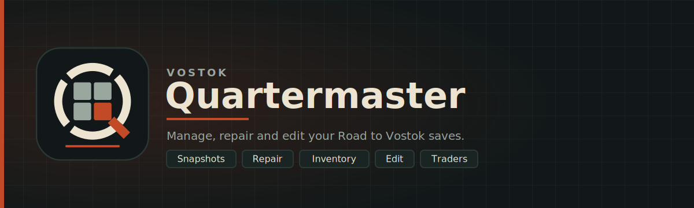

<p align="center">
  
</p>

# Vostok Quartermaster

Back up, repair, inspect and edit your **Road to Vostok** saves. A lightweight Windows app: portable, nothing to install.

> **Unofficial tool. Not affiliated with the Road to Vostok Ltd.**
> Keep your own copy of `%AppData%\Road to Vostok\` the first time you try any save tool.

## Why "Quartermaster"?

A quartermaster is the person who keeps track of the camp's stores: what you have, where it is kept, and what needs fixing before the next trip out. You spend half of Road to Vostok hauling crates and counting ammo, so this app plays quartermaster for your save. It keeps your stockpile in view, backs it up, and repairs it when something goes missing. (Also, "Save Manager" sounded boring. XD)

## Features

- **Snapshots:** back up your whole save folder with an optional tag, restore any snapshot, and see the day, time, season, difficulty, weather and an Ironman badge for each one. Snapshot folders are named after your tag. Restoring first backs up your current save automatically, and checks for Read-only files before it changes anything.
- **Auto backup (off by default):** creates a snapshot a few seconds after the game saves. The newest 20 automatic snapshots are kept; manual ones and "Before restore" copies are never removed. A skip list leaves cache folders out of snapshots.
- **Repair:** finds items that come from mods which are no longer installed (the usual reason a save stops loading after a game update) and writes a cleaned copy as a new snapshot. Anything stored inside a removed item, such as a furniture locker, goes with it.
- **Inventory:** the equipment screen laid out like the game's (20 slots from primary weapon to cassette player) and the carried items on the same 8x13 grid, with the game's own item icons. Clicking an item on a grid or slot finds its row in the list, and clicking a row flashes the item on the grid. Edit mode (**experimental**, see Limitations) changes condition and quantity, removes items, **adds items** to the carried grid, and **equips or removes gear** in any slot from the items the game allows there.
- **Weapon builds:** in edit mode **Weapon...** opens a build screen: the weapon in the middle and a box for each fitting (magazine, optic, muzzle, laser), chosen from the weapon's compatible list in the game files, plus rounds loaded and the chamber. A weapon can also be equipped with its attachments in one step. Rigs get **Plates...** (the rig's condition is its plate's, so a new plate starts at 100% and no plate means no condition) and the cassette player gets **Cassette...**.
- **Shelter:** every container in every shelter, drawn as an item list plus a visual grid with item icons and rotation, with warnings for items that overlap, sit outside the grid or have an unknown size. Click an item to find it in the list. Edit mode changes or removes items and can **add items** to a container (**experimental**, see Limitations), including all the reward items of a trader task. Loose items lying in a shelter are listed too.
- **Character:** change character meters (health, energy, hydration, temperature, mental, reputation, stamina, cat health), conditions, cat found, and world values (day, time, difficulty, weather). **Heal all** fills in full health for you to review.
- **Traders:** tasks per trader (Generalist, Doctor, Gunsmith, Driver, Hunter), with the portrait from the game, the current trade tax and what each task needs and rewards. Edit mode sets any task to Not started, In progress or Completed and shows the new tax as you go.
- **Settings:** save folder, game folder (found automatically in the default Steam location), backups folder, skip list, auto backup, the unsaved-changes warning, sizes you gave for modded items, the weapon-magazine option, **Troubleshooting** (folder access test and permission reset help), and an About section with the version and an update checker.

Every editor writes a **new snapshot** and never touches your live save. You restore the edited copy yourself, with the game closed. If you leave a page or close the app with changes that are not in an edited copy yet, you are warned first (Settings can turn that off).

A **Mods** tab is planned and shows as "Soon" in the sidebar.

## Install (players)

1. Download the latest build from [Releases](https://github.com/PR0Gorib/VostokQuartermaster/releases): either the **portable `.exe`** (nothing to install) or the **installer**.
2. Run it. It finds your save folder (`%AppData%\Road to Vostok\`) on its own.
3. For item icons, the grids, Repair, weapon builds and adding items, it needs your game folder (the one containing `RTV.pck` and `mods`). If the game is not in the default Steam location (`C:\Program Files (x86)\Steam\steamapps\common\Road to Vostok`), choose it in **Settings → Game folder**.

Requirements: Windows 10 or 11 with Microsoft WebView2 (included with current Windows).

Where things are kept:

| What | Where |
|---|---|
| Game saves | `%AppData%\Road to Vostok\` |
| Quartermaster snapshots | `%AppData%\com.pr0gorib.vostokquartermaster\backups\` (Settings → Backups folder → Show in Explorer) |

Item icons and trader portraits are read from your own game files when needed. They are never copied into the app, its backups or this repository.

**Updates:** the app asks GitHub for the latest release number at startup (at most once a day) and shows a link if there is a newer version. Nothing is downloaded or installed. You can turn it off in Settings → About.

## How it works

- **Saves are Godot `.tres` text resources.** `src/tres.js` reads them as their original lines and only replaces single lines, removes whole blocks or inserts new ones, so a file you did not change round-trips byte for byte (spacing, number formats, line endings).
- **Repair** lists each `ext_resource` that points into `res://mods/<name>/`, compares the names with the folders in the game's `mods` folder, and for every missing mod removes the item slots that use it, anything nested or stored inside those slots, and the now unused `ext_resource`. A validator then checks that no reference is left dangling.
- **Character edit** only replaces the value on a property's own line. Values are clamped and formatted the way the game writes them.
- **Inventory and Shelter edit** read each item's definition from the game files (`size`, `showCondition`, `showAmount`, `maxAmount`, `stackable`, `slots`, `compatible`) to decide which fields and choices make sense. Before anything is written, the new file is checked: no dangling references, and every sub-resource defined before it is used, which Godot requires. If a check fails, nothing is written. References that an edit leaves unused are dropped from the file.
- **Adding items** places each new item in the first free spot (row by row, then rotated), using the item's real size. It is all-or-nothing: if everything does not fit, nothing is added. New entries are written in the same property order the game uses. Items from mods have no size in the game files, so Quartermaster asks for it once and remembers it.
- **Equipment and weapons:** an equipped item is a slot entry named after its equipment slot (`Primary`, `Rig`, `Grenade_1`, ...). A weapon's magazine, optic, muzzle device, laser, and a rig's armor plates, are stored as references in its `nested` list; the choices offered are the item's own `compatible` list. A rig's `condition` is its plate's.
- **Trader tasks:** a task is completed when its name is in the trader's list, in progress when its task note is in `taskNotes`, and not started when it is in neither. Completing a task here does not run its reward.
- **Icons** come from the game's `RTV.pck`. `src/pck.js` reads the pack's file table (Godot 4, pack format 3) without loading the multi-gigabyte file, finds an item's `Icon_*.png.import` next to its definition, and decodes the S3TC (DXT1/3/5) texture it names to a PNG in memory.
- **Trade tax** follows the game's rule: base tax minus a tenth of it for every finished task (Generalist 100%, Doctor 200%, Gunsmith 300%, Driver 200%, Hunter 200%). It fits all five traders.

## Build your own

### Prerequisites

Before building from source, make sure you have:

- [Node.js](https://nodejs.org/) (LTS recommended)
- [Rust](https://rustup.rs/) (stable toolchain)
- Microsoft C++ Build Tools ("Desktop development with C++") and WebView2, as described in the [Tauri v2 prerequisites](https://v2.tauri.app/start/prerequisites/)

### Setup

```bash
git clone https://github.com/PR0Gorib/VostokQuartermaster.git
cd VostokQuartermaster
npm install
npm run tauri dev       # run in development
```

### Build a release

```bash
npm run tauri build                          # installer + binary
cargo tauri build --no-bundle                # portable .exe only (run in src-tauri/)
```

The built installer/binary will be under `src-tauri/target/release/`.

## Notes for developers

- Tauri v2 with `withGlobalTauri: true`, so plugin APIs are on `window.__TAURI__` and no imports are needed. Plugins: `fs` (with the `watch` feature), `dialog`, `opener`, `window-state` and `persisted-scope`.
- Register `tauri_plugin_persisted_scope::init()` **last** in `lib.rs`. It remembers the folders a user picked, so the game folder stays readable after a restart.
- `capabilities/default.json` grants `core:default`, `opener:default`, `dialog:default`, `window-state:default` and these file permissions: `fs:allow-read-file`, `fs:allow-read-text-file`, `fs:allow-write-file`, `fs:allow-write-text-file`, `fs:allow-read-dir`, `fs:allow-copy-file`, `fs:allow-mkdir`, `fs:allow-remove`, `fs:allow-rename`, `fs:allow-exists`, `fs:allow-stat`, `fs:allow-watch`, `fs:allow-unwatch`, plus `fs:allow-open`, `fs:allow-read`, `fs:allow-seek` and `fs:allow-fstat` (needed to read `RTV.pck` without loading it).
- **CSP is strict:** no inline scripts and no inline `style="..."` attributes (use classes; setting `el.style` from JavaScript is fine). Images from `data:` URLs are allowed for the icons, and `connect-src` allows only `https://api.github.com` for the update check.
- The quit warning needs `core:window:allow-destroy` in the capabilities, because the window is closed from the front end after you confirm.
- The file scope allows `$DATA/Road to Vostok/**` and `$APPDATA/**`, and the default Steam game folder. Names that start with a dot (like `.persisted-scope`) are not matched by those patterns, so the app cannot touch that file; the reset help in Settings only shows the steps. Any other game folder is added at runtime when the user picks it in the dialog.
- Do not change the bundle identifier (`com.pr0gorib.vostokquartermaster`) once users have it: it decides where settings and backups are stored.
- The version lives in three places that must match: `package.json`, `src-tauri/Cargo.toml` and `src-tauri/tauri.conf.json`. For the update checker to see a release, tag it `vX.Y.Z` and publish it as a normal release (not a draft or prerelease).

## Project structure

```
VostokQuartermaster/
├── package.json              # scripts: tauri
├── src/                      # the whole frontend: plain HTML, CSS and JS, no bundler
│   ├── index.html            # sidebar, #view, toast, <dialog>; loads tres.js, pck.js, app.js
│   ├── styles.css
│   ├── tres.js               # lossless .tres reader/editor (window.Tres, also module.exports)
│   ├── pck.js                # Godot .pck reader, S3TC icon decoder, item-definition reader (window.Pck, also module.exports)
│   └── app.js                # the app: one IIFE, pages, snapshots, repair, editors
└── src-tauri/
    ├── Cargo.toml
    ├── tauri.conf.json       # window, bundle, CSP
    ├── capabilities/default.json   # permissions and file access scope
    ├── icons/
    └── src/lib.rs, main.rs   # plugin registration only, no custom commands
```

## Limitations

- **Adding items, equipping gear and weapon builds are experimental.** They have worked in testing, but they need more players trying them. They only offer base-game items. Always keep your original snapshot and test the edited copy.
- Modded furniture and modded items have unknown sizes: their grid is estimated from the items' positions until you tell Quartermaster the size, and they cannot be added or equipped. Modded items show a category glyph instead of an icon.
- Furniture task rewards cannot be added: furniture lives in the game's furniture catalog, which Quartermaster does not edit yet.
- Magazines are limited to the ones the game lists as compatible with a weapon. A setting also offers other magazines for the same ammo, for people using a magazine cross-compatibility mod.
- Tested on Road to Vostok Build 2 (v0.2.2.0). A game update can change the save format.

## Troubleshooting

- **"Forbidden path" or a permission error:** Quartermaster is only allowed to use certain folders. Open **Settings → Troubleshooting → Test folder access**; it tries each step of a backup and shows the exact error. **Copy result** puts it on the clipboard for a bug report. If a saved permission is the problem, **Reset folder permissions** shows how to clear it (close the app, delete `%AppData%\com.pr0gorib.vostokquartermaster\.persisted-scope`, start it again).
- **Restore says a file is Read-only:** Windows has marked a file in your save folder Read-only (some mod config files are). Untick Read-only in its Properties and restore again. Nothing is changed before that check.
- **A weapon or item does not load in game:** restore your original snapshot, then please report it with the item and what you changed.

## Contributing and bug reports

Issues and pull requests are welcome. For a bug report please include your game version, what you did, and what you expected. Do not attach save files or game assets you do not want to share.

## Credits

Quartermaster follows the ideas of two earlier community tools. Both are MIT licensed; their code was not copied, the code here is written from scratch.

- [VostokVault](https://github.com/jonigirl/vostok-vault) by jonigirl: backup, restore and save repair.
- [RTV Save Editor](https://github.com/FINDarkside/Road-to-Vostok-Save-Editor) by FINDarkside: save viewing and editing.

Built with [Tauri](https://tauri.app/). *Road to Vostok* and its art belong to their respective owners.

## License

This project is licensed under the MIT License - see the [LICENSE](LICENSE) file for details. This applies to the code in this repository only, not to *Road to Vostok* or any of its assets.
