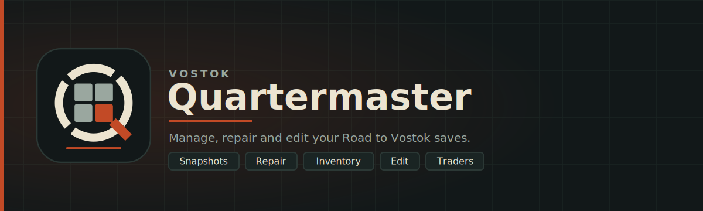

[](https://hub.xerj.org/contributors/PR0Gorib)

<p align="center">
  
</p>

# Vostok Quartermaster

Back up, repair, inspect and edit your **Road to Vostok** saves. A lightweight Windows app: portable, nothing to install.

> **Unofficial tool. Not affiliated with the Road to Vostok Ltd.**
> Keep your own copy of `%AppData%\Road to Vostok\` the first time you try any save tool.

## Why "Quartermaster"?

A quartermaster is the person who keeps track of the camp's stores: what you have, where it is kept, and what needs fixing before the next trip out. You spend half of Road to Vostok hauling crates and counting ammo, so this app plays quartermaster for your save. It keeps your stockpile in view, backs it up, and repairs it when something goes missing. (Also, "Save Manager" sounded boring. XD)

## What's new in 1.3.0

- **Road to Vostok 0.2.3.1 support**, including the Nomad fields added to `World.tres`: set **Nomads remaining** on the Character page and see the **Nomads met** list.
- **Moving items by drag and drop**, in edit mode: inside a container, between containers, and between your inventory and a shelter (pick the item up in the inspector, open the other page, drop it where you want). Loose items in a shelter can be dropped into containers too. `R` turns an item, the arrow keys nudge it, `Ctrl+Z` undoes, and a drop that does not fit is refused.
- **Traders overhaul:** one trader at a time with portrait tiles, all ten tasks with Not started / In progress / Completed buttons, item icons for what a task needs and rewards, and a **Can stock** list per trader read from your game files, with prices that include the trader's current tax (ammo is priced per stack, with the price of one round).
- **Character overhaul:** vitals with sliders, conditions as toggle chips, changed values highlighted with a reset button, and a World card.
- **Inventory and Shelter inspector** shows each item's rarity and value. The Shelter page opens in the visual view by default.
- **Snapshots:** manual snapshots first, automatic backups in a collapsible group, an All / Manual / Auto filter and relative times ("26 min ago").
- **Repair:** shows exactly which items will be removed and where they are, and warns when removing a mod's furniture also deletes items stored inside it.
- **Fix:** removing a loose item that shares its data with another loose item no longer damages the other one.

## Features

- **Snapshots:** back up your whole save folder with an optional tag, restore any snapshot, and see the day, time, season, difficulty and weather for each one (with an Ironman badge). Your manual snapshots are listed first, automatic backups sit in a collapsible group, and an All / Manual / Auto filter and relative times ("26 min ago", exact time on hover) make a long list easy to scan. Snapshot folders are named after your tag. Restoring first backs up your current save automatically, and checks for Read-only files before it changes anything.
- **Auto backup (off by default):** creates a snapshot a few seconds after the game saves. The newest 20 automatic snapshots are kept; manual ones and "Before restore" copies are never removed. A skip list leaves cache folders out of snapshots.
- **Repair:** finds items that come from mods which are no longer installed (the usual reason a save stops loading after a game update) and writes a cleaned copy as a new snapshot. Each mod has an expandable list of the items that will be removed and where they are (carried, equipped, in which container of which shelter, on the floor, or in the furniture catalog). Anything stored inside a removed item, such as a furniture locker, goes with it: the page warns you and shows what that is. After cleaning, a short report lists what was removed.
- **Inventory:** the equipment screen laid out like the game's (20 slots from primary weapon to cassette player) and the carried items on the same 8x13 grid, with the game's own item icons. Clicking an item on a grid or slot finds its row in the list, and clicking a row flashes the item on the grid. The inspector shows the selected item's condition, quantity, rarity and value (ammo as price per stack and per round). Edit mode (**feedback needed**, see Limitations) changes condition and quantity, removes items, **adds items** to the carried grid, **moves items** by drag and drop, and **equips or removes gear** in any slot from the items the game allows there.
- **Weapon builds:** in edit mode **Weapon...** opens a build screen: the weapon in the middle and a box for each fitting (magazine, optic, muzzle, laser), chosen from the weapon's compatible list in the game files, plus rounds loaded and the chamber. A weapon can also be equipped with its attachments in one step. Rigs get **Plates...** (the rig's condition is its plate's, so a new plate starts at 100% and no plate means no condition) and the cassette player gets **Cassette...**.
- **Shelter:** every container in every shelter, drawn as an item list plus a visual grid with item icons and rotation, with warnings for items that overlap, sit outside the grid or have an unknown size. Click an item to find it in the list. The page opens in the visual view; a list view is one click away. Edit mode changes or removes items, can **add items** to a container (**feedback needed**, see Limitations), including all the reward items of a trader task, and **moves items** by drag and drop. Loose items lying in a shelter are listed too, and can be picked up and dropped into a container.
- **Moving items (edit mode):** drag an item on a grid to move it. The drop is previewed green when it fits and red when it does not, and a red drop is refused (nothing is swapped, like in the game). `R` turns the item while you drag, the arrow keys nudge the selected item, `Esc` cancels a drag and `Ctrl+Z` (or **Undo move**) steps back through your moves; the inspector also has **Undo this move** for the selected item. Drag onto another container's grid to move it there. To move an item between your inventory and a shelter, select it, press **Pick up** in the inspector, open the other page and drag the item from the inspector card onto a grid. A moved item keeps everything about it (condition, quantity, chamber, magazine) and counts as one change. Items that hold other items cannot be moved yet. A modded item must have its size entered first.
- **Character:** change character meters (health, energy, hydration, temperature, mental, reputation, stamina, cat health) with sliders, conditions as toggle chips, cat found, and world values (day, time, season, difficulty, weather, **Nomads remaining**). Anything you change is highlighted and has its own reset button, and **Heal all** fills in full health for you to review. The reputation field tells you whether roaming Nomads will trade with you (50 or more). **Nomads met** lists the Nomads you have interacted with (read-only). Cat editing is marked **feedback needed**: the cat has to be found in game first.
- **Traders:** pick a trader from the tiles (portrait, tasks done and current trade tax) and see all ten tasks in the game's order with what each needs and rewards, shown with item icons. Edit mode sets any task to Not started, In progress or Completed with three buttons and shows the new tax as you go. Under the tasks, **Can stock** lists the items the trader can sell, read from your game files, with each price being the item's base value plus the trader's current tax (so the prices fall as you finish tasks). Ammo is priced per stack, followed by the price of one round.
- **Settings:** save folder, game folder (found automatically in the default Steam location), backups folder, skip list, auto backup, the unsaved-changes warning, sizes you gave for modded items, the weapon-magazine option, **Troubleshooting** (folder access test and permission reset help), and an About section with the version and an update checker.

Every editor writes a **new snapshot** and never touches your live save. You restore the edited copy yourself, with the game closed. If you leave a page or close the app with changes that are not in an edited copy yet, you are warned first (Settings can turn that off).

Planned: a **Mods** tab (shown as "Soon" in the sidebar), dropping items onto equipment slots, and a Repair option to rescue your own items from a removed mod's furniture before it is cleaned.

## Install (players)

1. Download the latest build from [Releases](https://github.com/PR0Gorib/VostokQuartermaster/releases): either the **portable `.exe`** (nothing to install) or the **installer**.
2. Run it. It finds your save folder (`%AppData%\Road to Vostok\`) on its own.
3. For item icons, the grids, Repair, weapon builds and adding items, it needs your game folder (the one containing `RTV.pck` and `mods`). If the game is not in the default Steam location (`C:\Program Files (x86)\Steam\steamapps\common\Road to Vostok`), choose it in **Settings → Game folder**.

Requirements: Windows 10 or 11 with Microsoft WebView2 (included with current Windows).

Where things are kept:

| What | Where |
|---|---|
| Game saves | `%AppData%\Road to Vostok\` |
| Quartermaster snapshots | `%AppData%\com.pr0gorib.vostokquartermaster\backups\` (Settings → Backups folder → Show in Explorer) |

Item icons and trader portraits are read from your own game files when needed. They are never copied into the app, its backups or this repository.

**Updates:** the app asks GitHub for the latest release number at startup (at most once a day) and shows a link if there is a newer version. Nothing is downloaded or installed. You can turn it off in Settings → About.

## How it works

- **Saves are Godot `.tres` text resources.** `src/tres.js` reads them as their original lines and only replaces single lines, removes whole blocks or inserts new ones, so a file you did not change round-trips byte for byte (spacing, number formats, line endings).
- **Repair** lists each `ext_resource` that points into `res://mods/<name>/`, compares the names with the folders in the game's `mods` folder, and for every missing mod removes the item slots that use it, anything nested or stored inside those slots, and the now unused `ext_resource`. A validator then checks that no reference is left dangling.
- **Character edit** only replaces the value on a property's own line. Values are clamped and formatted the way the game writes them. The Nomad fields added in game 0.2.3.0 (`nomadsRemaining`, `nomadsDiscovered`) are in `World.tres`; `nomadsRemaining` is editable (0 to 100) and the others, such as the refill timer `nomadRefill`, are left alone.
- **Inventory and Shelter edit** read each item's definition from the game files (`size`, `showCondition`, `showAmount`, `maxAmount`, `defaultAmount`, `stackable`, `slots`, `compatible`, `value`, `rarity` and the per-trader flags) to decide which fields and choices make sense. Before anything is written, the new file is checked: no dangling references, and every sub-resource defined before it is used, which Godot requires. If a check fails, nothing is written. References that an edit leaves unused are dropped from the file.
- **Adding items** places each new item in the first free spot (row by row, then rotated), using the item's real size. It is all-or-nothing: if everything does not fit, nothing is added. New entries are written in the same property order the game uses. Items from mods have no size in the game files, so Quartermaster asks for it once and remembers it.
- **Equipment and weapons:** an equipped item is a slot entry named after its equipment slot (`Primary`, `Rig`, `Grenade_1`, ...). A weapon's magazine, optic, muzzle device, laser, and a rig's armor plates, are stored as references in its `nested` list; the choices offered are the item's own `compatible` list. A rig's `condition` is its plate's.
- **Moving items** is written as a removal in the old container plus an addition in the new one. The addition copies every saved property of the item (condition, quantity, chamber, casing, firing mode, nested magazine and attachments), so the item arrives exactly as it was, and only the grid position and rotation are new. This also works between files (your inventory is in `Character.tres`, each shelter in its own file), where the internal reference numbers differ. Items that hold other items are refused. The moved item is removed from its old grid at once, and Undo puts it back. A loose item in a shelter is a thin wrapper around the same slot data a container item uses, so moving it into a container drops the wrapper and keeps the slot data.
- **Shared item data:** a save can store the same slot data once and point several loose items at it. Removing an item only deletes data that nothing else still uses.
- **Trader tasks:** a task is completed when its name is in the trader's list, in progress when its task note is in `taskNotes`, and not started when it is in neither. Completing a task here does not run its reward.
- **Icons** come from the game's `RTV.pck`. `src/pck.js` reads the pack's file table (Godot 4, pack format 3) without loading the multi-gigabyte file, finds an item's `Icon_*.png.import` next to its definition, and decodes the S3TC (DXT1/3/5) texture it names to a PNG in memory.
- **Trade tax** follows the game's rule: base tax minus a tenth of it for every finished task (Generalist 100%, Doctor 200%, Gunsmith 300%, Driver 200%, Hunter 200%). It fits all five traders. Prices on the Traders page add that tax to the item's base value.
- **What a trader can stock:** every item and furniture definition in the game has one true/false flag per trader (`generalist`, `doctor`, `gunsmith`, `driver`, `hunter`, `grandma`). A trader's list is every item whose flag for that trader is set. Quartermaster reads the definitions once and caches the result. If the flags cannot be read, it shows a bundled list for game version 0.2.3.1 and says so.
- **Rarity and value** come from the item definition. The game stores rarity as a number (1 is Rare, 2 is Legendary; a missing value means Common). For ammo the value is the price of a full stack (the item's default amount), so the price of one round is the stack price divided by the stack size.

## Build your own

### Prerequisites

Before building from source, make sure you have:

- [Node.js](https://nodejs.org/) (LTS recommended)
- [Rust](https://rustup.rs/) (stable toolchain)
- Microsoft C++ Build Tools ("Desktop development with C++") and WebView2, as described in the [Tauri v2 prerequisites](https://v2.tauri.app/start/prerequisites/)

### Setup

```bash
git clone https://github.com/PR0Gorib/VostokQuartermaster.git
cd VostokQuartermaster
npm install
npm run tauri dev       # run in development
```

### Build a release

```bash
npm run tauri build                          # installer + binary
cargo tauri build --no-bundle                # portable .exe only (run in src-tauri/)
```

The built installer/binary will be under `src-tauri/target/release/`.

## Notes for developers

- Tauri v2 with `withGlobalTauri: true`, so plugin APIs are on `window.__TAURI__` and no imports are needed. Plugins: `fs` (with the `watch` feature), `dialog`, `opener`, `window-state` and `persisted-scope`.
- Register `tauri_plugin_persisted_scope::init()` **last** in `lib.rs`. It remembers the folders a user picked, so the game folder stays readable after a restart.
- `capabilities/default.json` grants `core:default`, `opener:default`, `dialog:default`, `window-state:default` and these file permissions: `fs:allow-read-file`, `fs:allow-read-text-file`, `fs:allow-write-file`, `fs:allow-write-text-file`, `fs:allow-read-dir`, `fs:allow-copy-file`, `fs:allow-mkdir`, `fs:allow-remove`, `fs:allow-rename`, `fs:allow-exists`, `fs:allow-stat`, `fs:allow-watch`, `fs:allow-unwatch`, plus `fs:allow-open`, `fs:allow-read`, `fs:allow-seek` and `fs:allow-fstat` (needed to read `RTV.pck` without loading it).
- **CSP is strict:** no inline scripts and no inline `style="..."` attributes (use classes; setting `el.style` from JavaScript is fine). Images from `data:` URLs are allowed for the icons, and `connect-src` allows only `https://api.github.com` for the update check.
- The quit warning needs `core:window:allow-destroy` in the capabilities, because the window is closed from the front end after you confirm.
- The file scope allows `$DATA/Road to Vostok/**` and `$APPDATA/**`, and the default Steam game folder. Names that start with a dot (like `.persisted-scope`) are not matched by those patterns, so the app cannot touch that file; the reset help in Settings only shows the steps. Any other game folder is added at runtime when the user picks it in the dialog.
- Do not change the bundle identifier (`com.pr0gorib.vostokquartermaster`) once users have it: it decides where settings and backups are stored.
- The version lives in three places that must match: `package.json`, `src-tauri/Cargo.toml` and `src-tauri/tauri.conf.json`. For the update checker to see a release, tag it `vX.Y.Z` and publish it as a normal release (not a draft or prerelease).

## Project structure

```
VostokQuartermaster/
├── package.json              # scripts: tauri
├── src/                      # the whole frontend: plain HTML, CSS and JS, no bundler
│   ├── index.html            # sidebar, #view, toast, <dialog>; loads tres.js, pck.js, app.js
│   ├── styles.css
│   ├── tres.js               # lossless .tres reader/editor (window.Tres, also module.exports)
│   ├── pck.js                # Godot .pck reader, S3TC icon decoder, item-definition reader (window.Pck, also module.exports)
│   └── app.js                # the app: one IIFE, pages, snapshots, repair, editors
└── src-tauri/
    ├── Cargo.toml
    ├── tauri.conf.json       # window, bundle, CSP
    ├── capabilities/default.json   # permissions and file access scope
    ├── icons/
    └── src/lib.rs, main.rs   # plugin registration only, no custom commands
```

## Limitations

- **Adding items, moving items, equipping gear, weapon builds and cat editing are marked "feedback needed".** They have worked in testing, but they need more players trying them. Adding and equipping only offer base-game items. Always keep your original snapshot and test the edited copy.
- Items that hold other items cannot be moved yet. A weapon you changed in the weapon build screen and then moved arrives as it is saved (the unsaved workbench changes are not carried). You cannot drop items onto equipment slots yet, and an item cannot be put on the floor of a shelter.
- Some loose items in a shelter share one record in the save. Changing the condition of one changes all that share it.
- Modded furniture and modded items have unknown sizes: their grid is estimated from the items' positions until you tell Quartermaster the size, and they cannot be added or equipped. Modded items show a category glyph instead of an icon.
- Furniture task rewards cannot be added: furniture lives in the game's furniture catalog, which Quartermaster does not edit yet.
- Magazines are limited to the ones the game lists as compatible with a weapon. A setting also offers other magazines for the same ammo, for people using a magazine cross-compatibility mod.
- Tested on Road to Vostok Build 2 (v0.2.3.1). A game update can change the save format.

## Troubleshooting

- **"Forbidden path" or a permission error:** Quartermaster is only allowed to use certain folders. Open **Settings → Troubleshooting → Test folder access**; it tries each step of a backup and shows the exact error. **Copy result** puts it on the clipboard for a bug report. If a saved permission is the problem, **Reset folder permissions** shows how to clear it (close the app, delete `%AppData%\com.pr0gorib.vostokquartermaster\.persisted-scope`, start it again).
- **Restore says a file is Read-only:** Windows has marked a file in your save folder Read-only (some mod config files are). Untick Read-only in its Properties and restore again. Nothing is changed before that check.
- **A weapon or item does not load in game:** restore your original snapshot, then please report it with the item and what you changed.

## Contributing and bug reports

Issues and pull requests are welcome. For a bug report please include your game version, what you did, and what you expected. Do not attach save files or game assets you do not want to share.

## Credits

Quartermaster follows the ideas of two earlier community tools. Both are MIT licensed; their code was not copied, the code here is written from scratch.

- [VostokVault](https://github.com/jonigirl/vostok-vault) by jonigirl: backup, restore and save repair.
- [RTV Save Editor](https://github.com/FINDarkside/Road-to-Vostok-Save-Editor) by FINDarkside: save viewing and editing.

Built with [Tauri](https://tauri.app/). *Road to Vostok* and its art belong to their respective owners.

## License

This project is licensed under the MIT License - see the [LICENSE](LICENSE) file for details. This applies to the code in this repository only, not to *Road to Vostok* or any of its assets.
